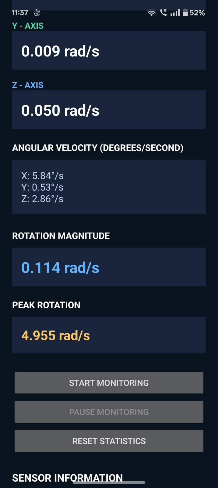
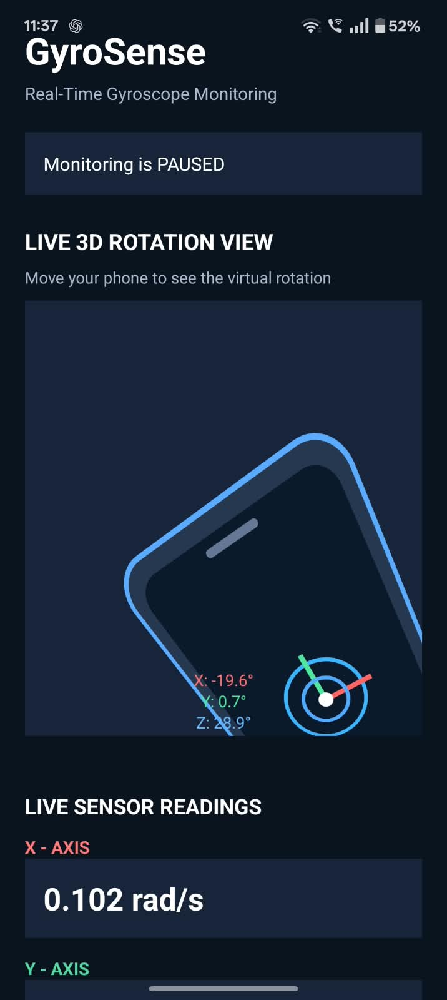
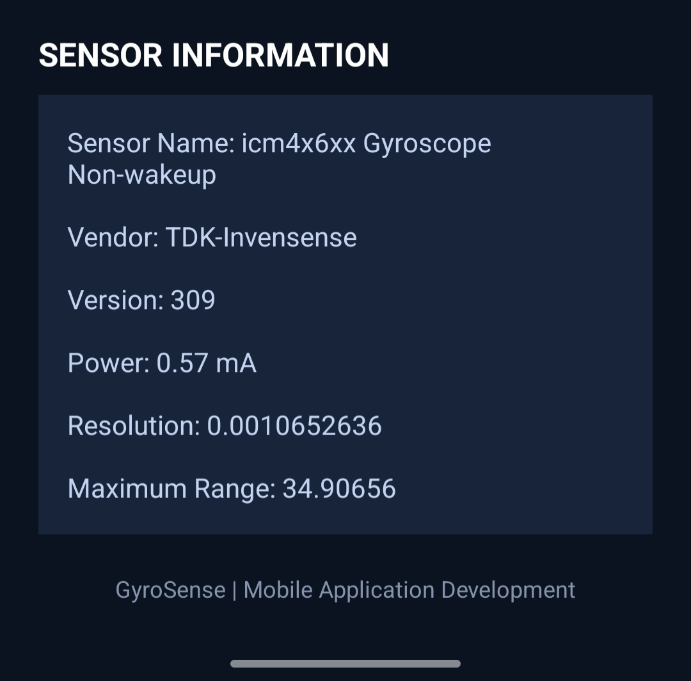

# GyroSense – Real-Time Gyroscope Sensor Monitoring App

**GyroSense** is an Android application developed using Java that provides real-time monitoring and visualization of gyroscope sensor data. It allows users to observe angular velocity along the X, Y, and Z axes and visualize device rotation through an interactive 3D smartphone model.

The application demonstrates how Android's built-in gyroscope sensor can be accessed and used to understand rotational movement in real time.

## 📱 Screenshots

### 1. Live Gyroscope Readings
Displays real-time angular velocity measurements along the X, Y, and Z axes.



### 2. 3D Rotation Visualization
Displays the virtual smartphone model rotating according to the device's gyroscope movements.



### 3. Sensor Hardware Information
Displays the technical specifications of the gyroscope sensor available on the device.



*Replace the image paths above with your actual screenshot filenames.*

## ✨ Features

- **Real-Time Sensor Monitoring:** Displays live gyroscope readings while the device is moving.
- **Three-Axis Measurement:** Shows angular velocity along the X, Y, and Z axes.
- **Unit Conversion:** Displays readings in radians per second (rad/s) and degrees per second (°/s).
- **3D Rotation Visualization:** Provides a virtual 3D smartphone model that rotates based on gyroscope data.
- **Rotation Magnitude:** Calculates the overall angular velocity using the three-axis readings.
- **Peak Rotation Tracking:** Records the highest observed rotation magnitude during a monitoring session.
- **Start and Pause Controls:** Allows users to start or pause sensor monitoring.
- **Reset Functionality:** Resets recorded statistics and the 3D rotation visualization.
- **Sensor Information:** Displays available gyroscope hardware details, including sensor name, vendor, version, power consumption, resolution, and maximum range.

## 🛠️ Technologies Used

- **Programming Language:** Java
- **Development Environment:** Android Studio
- **User Interface:** XML
- **Platform:** Android
- **Sensor API:** Android Sensor Framework
- **Sensor Used:** Gyroscope (`Sensor.TYPE_GYROSCOPE`)

## ⚙️ How It Works

GyroSense uses Android's built-in `SensorManager` to access the device's gyroscope sensor.

1. The application checks whether a gyroscope sensor is available on the device.
2. The `SensorEventListener` receives sensor data whenever the device rotates.
3. Angular velocity values are collected along the X, Y, and Z axes.
4. The readings are converted from radians per second to degrees per second for easier understanding.
5. Rotation magnitude is calculated using the three-axis values.
6. The readings are used to update the dashboard and the 3D rotation visualization.

### Rotation Magnitude Calculation

The overall angular velocity magnitude is calculated using:

\[
\text{Magnitude} = \sqrt{x^2+y^2+z^2}
\]

Where:
- `x` = Angular velocity along the X-axis
- `y` = Angular velocity along the Y-axis
- `z` = Angular velocity along the Z-axis

### Unit Conversion

\[
\text{Degrees/second} = \text{Radians/second} \times \frac{180}{\pi}
\]

## 📋 Requirements

- Android smartphone with a built-in gyroscope sensor
- Android Studio
- Android SDK
- USB cable or Android emulator for testing

**Note:** Actual gyroscope readings and physical rotation tracking require a device with a gyroscope sensor. The 3D visualization is an integrated estimate based on gyroscope readings and may experience drift over time.

## 🚀 Installation and Setup

1. Clone the repository:

   ```bash
   git clone https://github.com/Ni-sha-Shetty/GyroSense.git
   ```

2. Open Android Studio.

3. Select **Open** and choose the cloned `GyroSense` project folder.

4. Allow Gradle to sync and download the required dependencies.

5. Connect an Android device with a gyroscope sensor enabled.

6. Enable USB debugging if you are installing through Android Studio.

7. Click **Run** to build and launch the application.

## 🎯 Learning Outcomes

- Understanding Android sensor programming.
- Working with the Android Sensor Framework.
- Implementing real-time sensor data monitoring.
- Performing mathematical calculations on sensor readings.
- Understanding three-axis angular velocity.
- Creating custom views and basic 3D rotation visualizations.
- Developing an Android application using Java and XML.

## 🔮 Future Enhancements

- Integration of accelerometer data for improved motion analysis.
- More advanced 3D orientation visualization.
- Sensor data recording and historical graph visualization.
- Exporting sensor readings for further analysis.

## 👩‍💻 Developed By

**Nisha D. Shetty**

GitHub: [Ni-sha-Shetty](https://github.com/Ni-sha-Shetty)

## 📄 License

This project is developed for educational and academic purposes.